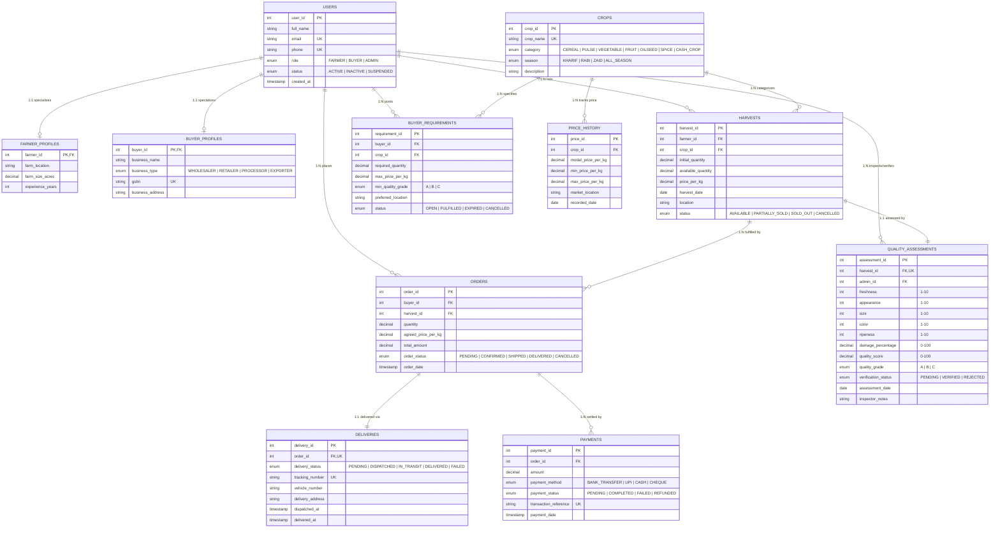

# AgriConnect — Entity-Relationship (ER) Model & Presentation Document

This document provides the formal **Entity-Relationship (ER) Diagram** and Relational Schema specification for the college DBMS project **AgriConnect — Farmer-to-Market Management System**.

---

## 1. Visual Entity-Relationship Diagram (Mermaid)

---

## 2. Relational Mapping & Foreign Key Cardinalities

| Relationship | Cardinality | Parent Entity | Child Entity | Foreign Key | Participation |
|---|---|---|---|---|---|
| User Specialization | 1:1 (optional) | `users` | `farmer_profiles` | `farmer_profiles.farmer_id -> users.user_id` | Total for Farmer role |
| User Specialization | 1:1 (optional) | `users` | `buyer_profiles` | `buyer_profiles.buyer_id -> users.user_id` | Total for Buyer role |
| Crop Categorization | 1:N | `crops` | `harvests` | `harvests.crop_id -> crops.crop_id` | Mandatory |
| Farmer Listing | 1:N | `users` | `harvests` | `harvests.farmer_id -> users.user_id` | Mandatory |
| Quality Inspection | 1:1 | `harvests` | `quality_assessments` | `quality_assessments.harvest_id -> harvests.harvest_id` | Mandatory per inspected batch |
| Admin Verification | 1:N | `users` | `quality_assessments` | `quality_assessments.admin_id -> users.user_id` | Mandatory |
| Buyer Demand | 1:N | `users` | `buyer_requirements` | `buyer_requirements.buyer_id -> users.user_id` | Mandatory |
| Crop Requirement | 1:N | `crops` | `buyer_requirements` | `buyer_requirements.crop_id -> crops.crop_id` | Mandatory |
| Crop Price History | 1:N | `crops` | `price_history` | `price_history.crop_id -> crops.crop_id` | Mandatory |
| Harvest Order | 1:N | `harvests` | `orders` | `orders.harvest_id -> harvests.harvest_id` | Mandatory |
| Buyer Purchase | 1:N | `users` | `orders` | `orders.buyer_id -> users.user_id` | Mandatory |
| Order Delivery | 1:1 | `orders` | `deliveries` | `deliveries.order_id -> orders.order_id` | Mandatory per dispatched order |
| Order Payment | 1:N | `orders` | `payments` | `payments.order_id -> orders.order_id` | Mandatory |

---

## 3. Normalization Summary (Academic Proof)

1. **First Normal Form (1NF)**:
   - Every attribute contains only atomic, indivisible values.
   - No multi-valued attributes or repeating groups (e.g., individual payment installments are rows in `payments`, not comma-separated lists in `orders`).
   - Every table possesses an explicit primary key (`user_id`, `crop_id`, `harvest_id`, etc.).

2. **Second Normal Form (2NF)**:
   - The schema is in 1NF.
   - No partial dependencies exist: every non-key column is functionally dependent on the **whole** primary key.
   - For 1:1 profile tables (`farmer_profiles`, `buyer_profiles`), the single attribute primary key (`farmer_id`, `buyer_id`) directly determines all respective profile fields.

3. **Third Normal Form (3NF)**:
   - The schema is in 2NF.
   - No transitive dependencies ($A \to B \to C$) exist among non-key attributes:
     - `orders` references `harvest_id` and stores snapshot `agreed_price_per_kg`, but farmer and crop metadata are isolated in `users` and `crops`.
     - Quality grading attributes (`freshness`, `size`, `damage_percentage`) are partitioned into `quality_assessments` rather than cluttering `harvests`.
     - Daily mandi market rates are stored in `price_history` rather than distorting static crop definitions.
